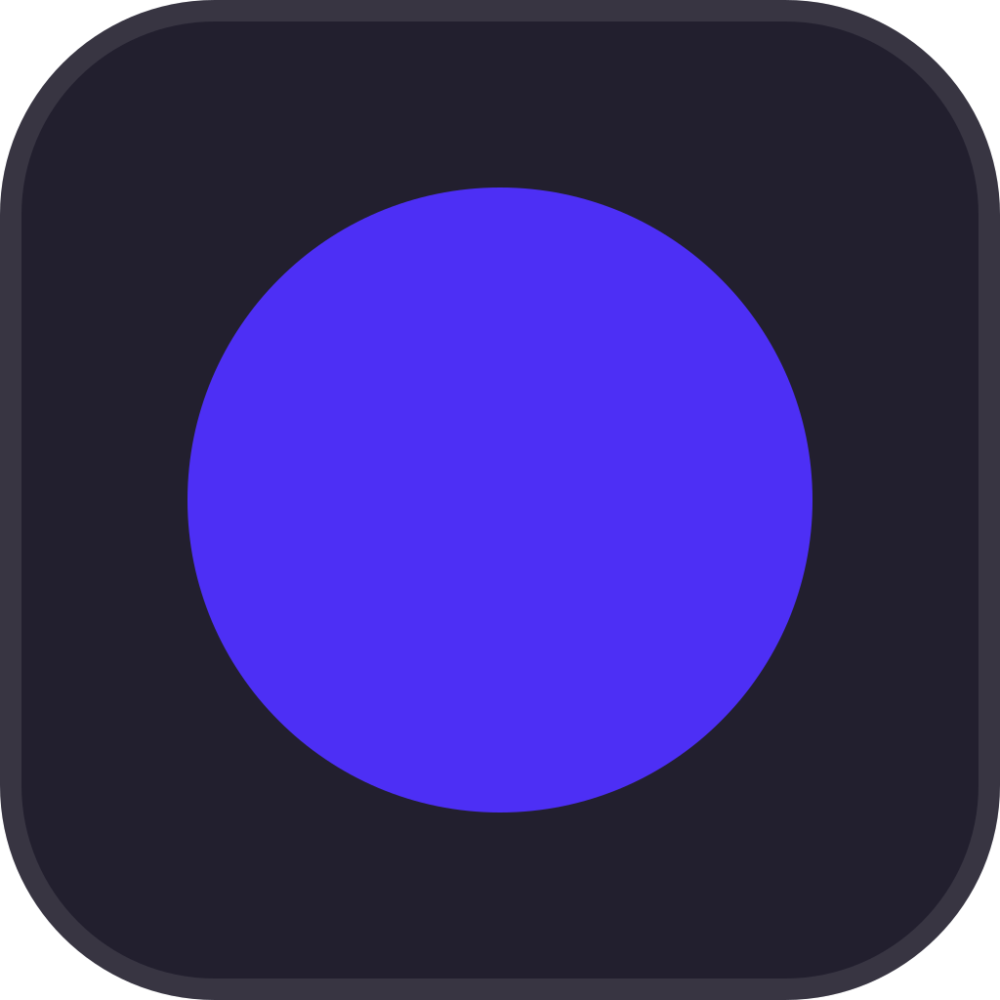

<div align="center">
  
  <h1>Beam</h1>
  <p><strong>Screen recording, beautifully simple.</strong></p>
  <p>
    Record your screen, your webcam, and your mic — trim, export, and get an offline AI transcript.
    No account, no subscription. Nothing ever leaves your PC.
  </p>
  <p><a href="https://github.com/rohzzn/beam/releases/latest"><strong>Download for Windows →</strong></a></p>
</div>

<br />

## What Beam does

Beam gives you the paid feature set of tools like Loom and Screen Studio, running entirely on your own machine.

- **Capture anything** — full screen, a single window, or a custom region you drag out yourself
- **Webcam bubble** — composites automatically as a circular overlay, freely draggable and resizable while you record
- **Auto-zoom** — the recording eases toward wherever you're clicking, then back out, so viewers always know where to look
- **Click ripples and a keystroke overlay** — optional, built for tutorials and product demos
- **A real editor** — multi-segment trim, export to MP4 or GIF, or copy the finished file straight to your clipboard
- **Offline AI transcription** — a local Whisper model generates captions on-device, no API key or internet required
- **Global hotkey** — start or stop from anywhere, even when Beam isn't focused
- **Microphone and system audio**, quality presets, a custom save location, and auto-updates in the background

Nothing here is a locked "pro" tier. It's all just included.

## Download

**[Download the latest version for Windows](https://github.com/rohzzn/beam/releases/latest)**

macOS and Linux are on the way — Beam is already built on cross-platform Electron.

## Why

Tools like Loom and Screen Studio are genuinely good, but they're subscriptions, and your recordings pass through someone else's server before they land on your own hard drive. Beam does the same job, entirely offline, for free, forever.

## Privacy

No account, no telemetry, no cloud sync — recordings are written straight to your disk. The only network call Beam ever makes is to GitHub, to check for app updates. Nothing about your screen, your recordings, or how you use the app leaves your machine.

---

<details>
<summary><strong>Building from source</strong></summary>
<br />

Beam is built with Electron, React, and TypeScript.

```bash
git clone https://github.com/rohzzn/beam.git
cd beam
npm install
npm run dev
```

```bash
npm run build:win    # Windows installer (.exe)
npm run build:mac    # macOS (.dmg)
npm run build:linux  # Linux (AppImage/deb/snap)
```

**How it's built:**

- **Capture**: `desktopCapturer` + `getDisplayMedia` — no native screen-capture dependencies
- **Encoding**: a bundled `ffmpeg-static` binary handles compositing, region cropping, auto-zoom, trimming, and GIF export
- **Input tracking**: `uiohook-napi` for global click/keystroke capture, powering click ripples, the keystroke overlay, and auto-zoom
- **Transcription**: a local Whisper model via `@huggingface/transformers`, entirely on-device
- **UI privacy**: the floating control bar and webcam bubble use `setContentProtection(true)`, so Beam's own interface never leaks into your recordings
- **Updates**: `electron-updater`, checking GitHub Releases in the background

```
src/
  main/        Electron main process — windows, recording pipeline, ffmpeg, transcription
  preload/     Typed IPC bridge between main and renderer
  renderer/    React UI (Home, control bar, webcam bubble, editor)
landing/       Static marketing site
build/         App icons and packaging resources
```

</details>

## Contributing

Issues and PRs are welcome.

## License

TBD.
